# herdr-sit-and-watch

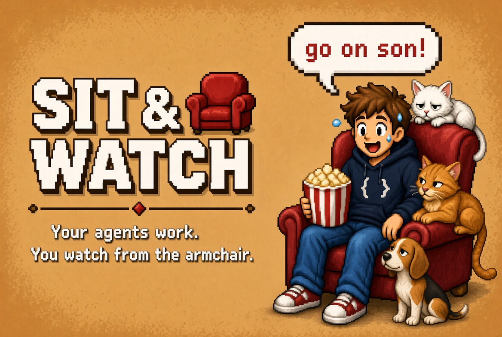

**Sit & Watch** is the Herdr sidebar where your agents are little robots at their desks and you are the
unhinged developer in the red armchair, getting progressively more unwell as they cook.

Your agents are cooking.  
You are not.

Sit & Watch drops a little red armchair in the corner of Herdr. Every agent is a tiny robot at a desk.
You are the developer in the chair with the popcorn, the foam finger, and the increasingly unhinged
commentary.

One agent: quiet but lethal.  
Two: "go on son".  
Four: standing ovation, confetti, and the realisation that you have left your body.  
PR merged: KABOOM.  
All of them need you at once: face down in the popcorn.

The pets judge you. The power bar fills. The speech bubbles get worse. You cannot look away.

Install it. Sit down. Lose the plot in the best possible way. No network. Just you, the chair, and
the robots that are better at your job than you are.


A sidebar panel for the [Herdr app](https://herdr.dev). Your agents are little robots at their
desks. You are the developer in the red velvet armchair in the corner, watching them do all the
work. The more of them are working, the more excited you get. See
[sitandwatch/RECIPE.md](sitandwatch/RECIPE.md) for how it is built.

<p align="center">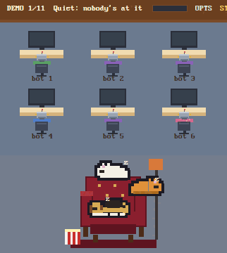<br>
The demo (click the header): a day at the desks.</p>

<table>
<tr><td align="center" valign="top">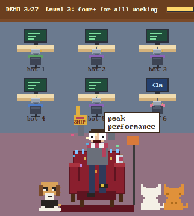<br>Four or more working: standing ovation</td><td align="center" valign="top">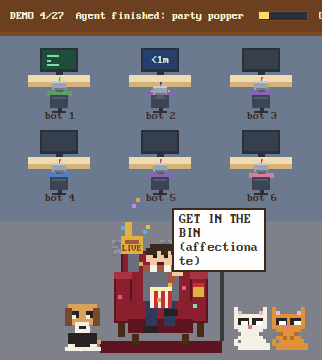<br>One finished: party popper</td><td align="center" valign="top">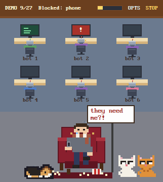<br>One needs you: the phone call</td></tr>
<tr><td align="center" valign="top">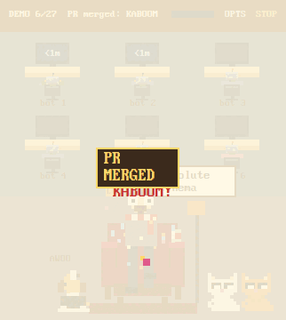<br>PR merged: KABOOM</td><td align="center" valign="top">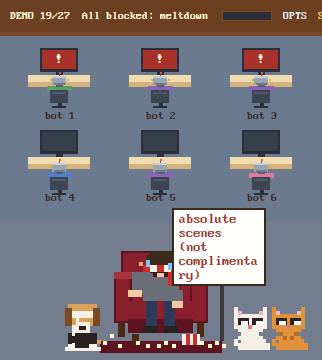<br>All of them need you: meltdown</td><td align="center" valign="top">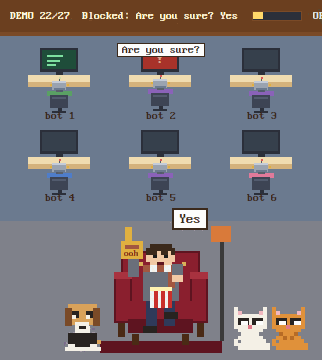<br>Every third block: "Are you sure?" "Yes"</td></tr>
<tr><td align="center" valign="top">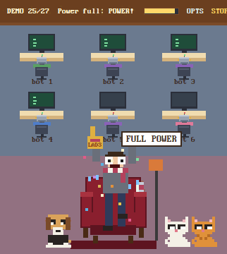<br>The power bar fills: POWER!</td><td align="center" valign="top">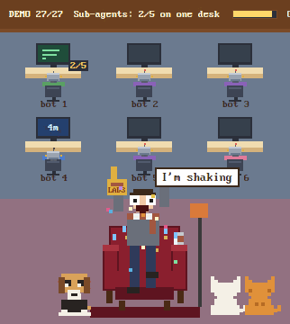<br>Claude Code sub-agents: 2/5 on one desk</td><td align="center" valign="top">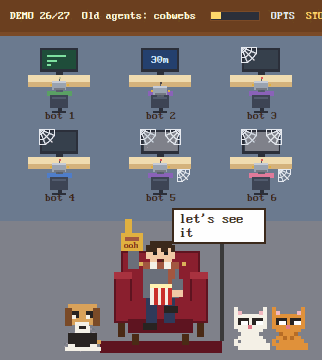<br>Old desks: cobwebs, and how long one has waited</td></tr>
<tr><td align="center" valign="top">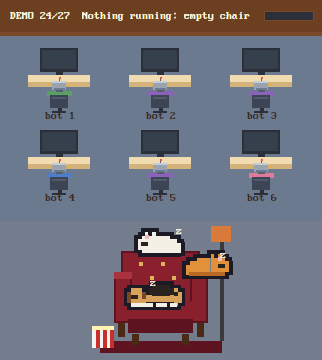<br>Nothing running: the pets take the chair</td><td></td><td></td></tr>
</table>

Each of these is one state of the demo tour (`herdr-app do sitandwatch.demo-<n>`). Recorded in Herdr; the header says which.

## What he does

| Agents working | In the chair |
| --- | --- |
| None | Nobody. An empty chair: Snowy asleep on the back, Buddy on the seat, Simba on the armrest, his popcorn on the floor. |
| One | Popcorn, a foam finger, eyebrows creeping up. "ooh" |
| Two or three | Clapping, wide eyes, sweating. "go on son!" |
| Four or more (or all of them) | Standing ovation, bulging eyes, confetti. "SHIP IT!" |
| One just finished | Party popper and a fist pump, popcorn flying. "GET IN!" |
| A branch pushed | A paper plane off his hand, `GO` on the foam finger. "pushed!" (needs the Claude Code hook, see below) |
| A PR opened | Holds up a scorecard reading `PR #11`, like the judges. "PR #11!" ... "who's reviewing?" (the hook again) |
| One needs you | Spilled popcorn, a tear, a phone call. "they need me?!" ... "on my way..." |
| Two or more need you | Both hands up, head whipping between desks. "which one?!" |
| They all need you, nobody's working | Face down, popcorn everywhere, two tears. "WHY DO I EVEN HAVE AGENTS" |
| Every third new block | The meme: "Are you sure?" over the desk, "Yes" from the chair. |
| One has needed you for 2+ minutes | Half out of the chair, a red arrow on that desk. "THAT one" |
| Three finished within a minute | Standing, both arms pumping, extra confetti. "they're flying!" |
| The same agent finished three times in ten minutes | A gold arrow on its desk, confetti. "HE'S ON FIRE" |
| Six or more working | Chaos: confetti that lingers, faster lines, a bigger head throw. |
| One crashed (exited non-zero) | Hands on his head, popcorn on the floor. "oh no" |
| A new agent appears | A nod, a green arrow on the new desk. "welcome" |
| One has been going 10+ minutes | Glazed over and slumping, a pillow after 30, slumped after 60. "I have a life too" |
| Two or more were busy and all stopped | Drops back into the chair. "ahh" ... "job done" |
| Agents working and you haven't touched Herdr in 5 minutes | Stares at you, eats slowly. "you still watching?" |
| After 10pm | A nightcap. "still at it?" |
| Nothing for 10 minutes | Back in the chair, dozing. "z Z", and now and then "popcorn's getting cold" |
| 10+ agents seen this session | Eyes darting about. "how many are there?" |
| The power bar fills | The bar in the header fills with every second an agent works (20 agent-minutes: about 7 with three at it) and drains slowly when nothing runs. Full: he leaps up, "POWER!", confetti, the pets wide awake. Then it starts again. |
| Desks | Each labelled with its tab's name, or its space's (the project) while the tab has Herdr's number. In last-active order: whoever's working first, then the one that stopped most recently. A finished agent shows how long it's been waiting on its screen (`12m`) until you answer it: looking isn't enough, it goes once the agent works again. A desk left alone for an hour gets a cobweb; after 8 hours it's covered, screen dusty. |
| Busy desks | A working desk's screen scrolls a little log (Read, Edit, Bash...; texture, not its real output). One working desk at a time says what it's on in a bubble: with the activity hook, what it's really doing right now ("Editing main.js", "Running npm test"); otherwise its terminal title (Claude Code sets it to the task). Renamed by screenshot mode when that's on. |
| Claude Code sub-agents | Shown on their session's desk as finished/total (`2/5`: five started, two finished), yellow while any run, green when all are done, gone 8 seconds later. They count as working agents: his level, the header count, the power bar, the welcome and the finish. Needs the sub-agent hook, see below. |
| The pets, any time he's there | Buddy, Snowy and Simba sit by the chair giving him a half-lidded side-eye. Meltdown: Buddy covers his eyes. Standing ovation: the cats turn their backs. Something ships: Buddy howls. After 10pm Simba's out. The loudest moment wins. |
| One crashed or needs you (popcorn spilled) | Buddy goes for the popcorn and eats it down over a minute. |
| Two or more at it for 10+ minutes | A cat knocks his can off the armrest (from the chair back once the pillow's there). |
| You click a pet | It says what it thinks of him: "Simba: pathetic", "Buddy: walk?", "Snowy: zzz" if you woke her. |
| Agents busy (now and then) | One of the pets gets up and wanders off the edge, back 25-75s later: Buddy out the left, Snowy and Simba out the right. Never while nothing is running. |
| Something shipped | Explosion with a PR MERGED, DEPLOYED or IT'S LIVE banner, bigger the first time. "KABOOM!" (needs the Claude Code hook, see below) |

Mostly Claude Code agents get a knowing nod, mostly Codex a side-eye, a mix "the whole team's in".
From level 2 there's a can on the armrest, and his scarf leans toward the colour of whoever's doing
most of the work. Each state has a pool of lines, shuffled per session. Click him and he talks back.

Click the header, or run `herdr-app do sitandwatch.demo`, to play the demo: a day at the desks, on a loop
(about 50s). It's quiet, work starts, agents and sub-agents ramp up and finish, a PR merges, then he
winds down, dozes and leaves the chair to the pets. The desks take your real agents' names where there
are some. Click again to stop. `demo-<n>` opens the labelled tour of all 27 states at state n.
Click a desk to jump to that agent.

### Minimise

Click **\_** at the right of the header (or run `herdr-app do sitandwatch.min`) to shrink the panel to a
30px strip: the count, the power bar and his face, still reacting.

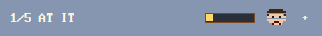
 In the sidebar it's a strip; docked
on the left or right of the window it's a 40px rail. Click **+** to bring it back to the size it had, or
drag it open. If Herdr can't shrink it (no id on its block, two Sit & Watch panels, or a block `min`
over 30), a message says why. Bring it back before removing the mod, or drag the block open after.

### Options

Click **OPTS** in the panel's header, or run `herdr-app do sitandwatch.options`, for:

- **Height:** 240, 300, 400 or 500px, or `layout` to give the block its size back. Remembered and
  put back after a Herdr restart; a drag of the line above the panel still wins until then. Also
  `herdr-app do sitandwatch.height-400` (or `height-layout`). Only in the sidebar (a column).
- **Floor:** slate (the default; the orange and tan pets stand out on it), tan (the original), deep
  teal, sage or night navy.
- **Pets:** switch Buddy, Snowy or Simba off. Recolour their coats in the `PETS` table in
  `art.js` (the names double as ids, so a rename needs a code change).
- **Speech bubbles:** off and he still reacts, silently.
- **Activity bubbles:** off and the desks show their task titles, not what each session is doing
  right now. The activity hook then sends nothing. Also `herdr-app do sitandwatch.activity`.
- **Chaos mode** and **developer mode**, the same as their commands below.

Choices are kept in Herdr's shared state, so they survive restarts.

### Screenshot mode

If the [screenshot mode](https://github.com/funny-it-worked-last-time-gsv/herdr-screenshot-mode) mods are
installed and switched on, every name Sit & Watch draws follows them: a renamed space or tab shows its alias
(`football-shares-frontend` as `FS-fe`), a hidden one its stand-in (`Space 2`, or the program's name for a tab).
Off, or not installed, names show as they are. `privacy.js` is screenshot mode's own file, copied in unchanged.

### Developer mode

`herdr-app do sitandwatch.dev` adds a strip under the header with the numbers the mood is picked
from (mood, level, counts, how long things have run, live one-shots). Its `buttons` chip shows rows to
force a level, pin a mood or fire any event. The same works from the command line:

```sh
herdr-app do sitandwatch.level-3          # or level-real
herdr-app do sitandwatch.mood-allBlocked  # any mood name, or mood-auto
herdr-app do sitandwatch.fire-streak      # finish, phone, collapse, burst, error, welcome, poke, merged, ...
herdr-app do sitandwatch.chaos            # chaos mode on for good, or off again
herdr-app do sitandwatch.desks-8h         # pretend idle desks are 1h or 8h old (cobwebs), or desks-real
```

## Installation

Ask your agent to add this mod (it reads every file first), or by hand:

1. Copy `sitandwatch/mods/sitandwatch` into `~/.config/herdr-app/mods/`.
2. Unless you want it somewhere else, it goes in the **bottom-left corner**: the bottom of the
   sidebar, under Agents and above Settings. Herdr won't dock it by itself (`"place": "none"`), so
   add this block to your layout's `sidebar` column, just before `sidebar-footer`:
   ```json
   { "id": "sitandwatch", "type": "block", "content": { "mod": "sitandwatch" }, "size": { "px": 300 } }
   ```
   Herdr's own layouts (`main`, ...) are read-only: clone one first
   (`herdr-app do layout.clone '{"name":"main"}'` makes and switches to `main-copy`) and edit the
   copy. Keep the id `sitandwatch`. To drag the panel's height by the line above it, give the `sidebar`
   column `"resizable": true` (Herdr's own layouts ship it off); or pick a height in Options.

Three optional Claude Code hooks live in `sitandwatch/hooks/`:

- **Ship:** the explosion on a `git push` to your main branch, `gh pr merge` or a production `vercel` deploy (setup in
  [RECIPE.md](sitandwatch/RECIPE.md#ship-hook)).
- **Sub-agents:** the `2/5` count. Copy `sitandwatch-subagents.py` to `~/.claude/hooks/` and add it to
  `~/.claude/settings.json` for both events:
  ```json
  "hooks": {
    "SubagentStart": [{ "hooks": [{ "type": "command", "command": "~/.claude/hooks/sitandwatch-subagents.py", "async": true, "timeout": 10 }] }],
    "SubagentStop":  [{ "hooks": [{ "type": "command", "command": "~/.claude/hooks/sitandwatch-subagents.py", "async": true, "timeout": 10 }] }]
  }
  ```
  It runs `herdr-app do sitandwatch.sub-start-<terminal>-<agent id>` (or `sub-stop-...`), using the
  `HC_TERMINAL_ID` Herdr gives each terminal, and never blocks or fails Claude Code.
- **Activity:** the desk bubbles say what each session is really doing. Copy `sitandwatch-activity.py`
  to `~/.claude/hooks/` and add it to `~/.claude/settings.json`:
  ```json
  "PreToolUse": [{ "hooks": [{ "type": "command", "command": "~/.claude/hooks/sitandwatch-activity.py", "async": true, "timeout": 10 }] }]
  ```
  Before each tool call it sends a short phrase (`Edit main.js`, `npm test`, `Grep
  useAuth`: a file's name, never its path or contents; a command's program and subcommand only, like `npm test`) as
  `herdr-app do sitandwatch.act-<terminal>-<base64url>`. One quick `herdr-app` run per tool call, in
  the background; it never blocks or fails Claude Code.

Delete the folder and that block to remove it (restore it first if minimised). It makes no network requests, runs no programs other than
`hc ls` and `hc get` (to see background agents, crashes and how long each agent has been busy) and
reads no files outside its folder (it reads screenshot mode's choices from Herdr's shared state). Nothing animates while
nothing is happening.

## History

Built over two days, mostly by Claude Code sessions working from short specs, each change checked
against screenshots of the live panel.

**31 October 2026**

- **First version.** Robots at desks, the developer in the armchair getting more excited the more
  agents work, a party popper when one finishes, a tear when one needs you. Built on
  zuccs/herdr-office-layout.
- **The ship explosion** ([#1](https://github.com/funny-it-worked-last-time-gsv/herdr-sit-and-watch/pull/1)). A fireball when a Claude Code session runs `git push`,
  `gh pr merge` or a production `vercel` deploy, sent by a Claude Code hook.
- **Moods** ([#2](https://github.com/funny-it-worked-last-time-gsv/herdr-sit-and-watch/pull/2), [#3](https://github.com/funny-it-worked-last-time-gsv/herdr-sit-and-watch/pull/3)). One dominant mood from what the agents are really doing: how
  long they've run (real times from herdr-core), crashes, bursts of finishes, blocked agents, late
  nights. The demo became the GIF at the top.
- **More personality, and developer mode** ([#4](https://github.com/funny-it-worked-last-time-gsv/herdr-sit-and-watch/pull/4)). Pools of lines, the meltdown, dozing,
  streaks, chaos mode, "Are you sure?" "Yes", and a strip for forcing any state while testing.

**1 November 2026**

- **Pets and the rest** ([#5](https://github.com/funny-it-worked-last-time-gsv/herdr-sit-and-watch/pull/5), [#6](https://github.com/funny-it-worked-last-time-gsv/herdr-sit-and-watch/pull/6)). Renamed Sit & Watch. Buddy, Snowy and Simba with
  their own reactions, the Options dialog and floors, minimise, the power bar, cobwebs on old desks,
  how long a finished agent has waited, sub-agent counts, a height adjuster, and offline checks with
  a snapshot of every mood decision.
- **A day at the desks** ([#7](https://github.com/funny-it-worked-last-time-gsv/herdr-sit-and-watch/pull/7)). The demo tells a story, busy desks show a log, and the
  activity hook makes each desk say what its session is doing right now.
- **Hook fixes** ([#8](https://github.com/funny-it-worked-last-time-gsv/herdr-sit-and-watch/pull/8), [#9](https://github.com/funny-it-worked-last-time-gsv/herdr-sit-and-watch/pull/9)). The ship hook judges each part of a compound command,
  and all three hooks load on Python 3.9.
- **Quieter, safer activity bubbles** ([#10](https://github.com/funny-it-worked-last-time-gsv/herdr-sit-and-watch/pull/10)). Repeats are skipped in the hook and the panel,
  secret-shaped words show as `***`, phrases fit the 20 characters a bubble shows (`Edit main.js`,
  `Run git push`, `> Review the diff`), and Options can turn the bubbles off.
- **Commands say what they do** ([#11](https://github.com/funny-it-worked-last-time-gsv/herdr-sit-and-watch/pull/11)). A command shows just its program (`git diff`, not
  `Run git diff`), and leading setup steps like `cd ~/proj &&` are skipped, so it names the real work.
- **Ship only on main; pushes and PRs get their own reactions** ([#12](https://github.com/funny-it-worked-last-time-gsv/herdr-sit-and-watch/pull/12)). Pushing a branch to
  open a PR no longer says "IT'S LIVE": only a push to main ships. A branch push sends a paper plane,
  and opening a PR has him hold up a scorecard reading the PR's number.

## Credits

Built on [zuccs/herdr-office-layout](https://github.com/zuccs/herdr-office-layout) (MIT): the pixel
art helpers, palette, font setup and the full-width office view (`role: "office"`) come from it.
The pixel font is [PxPlus IBM VGA 8x16](https://int10h.org/oldschool-pc-fonts/) by VileR, CC BY-SA
4.0, licence in `sitandwatch/mods/sitandwatch/fonts/`.
