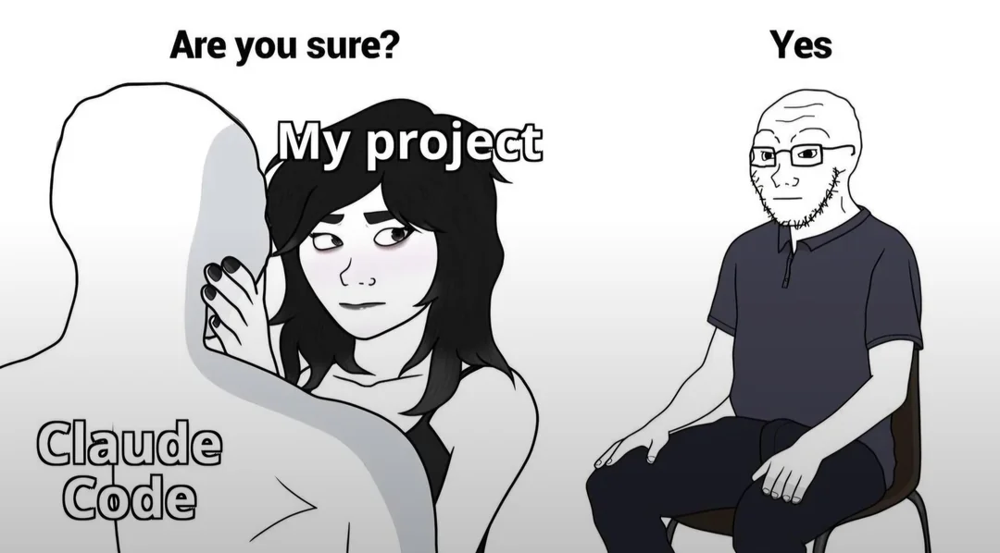

# herdr-sit-and-watch



A sidebar panel for the [Herdr app](https://herdr.dev). Your agents are little robots at their
desks. You are the developer in the red velvet armchair in the corner, watching them do all the
work. The more of them are working, the more excited you get. See
[sitandwatch/RECIPE.md](sitandwatch/RECIPE.md) for how it is built.


## What he does

| Agents working | In the chair |
| --- | --- |
| None | Nobody. An empty chair and a bucket of popcorn. |
| One | Popcorn, a foam finger, eyebrows creeping up. "ooh" |
| Two or three | Clapping, wide eyes, sweating. "go on son!" |
| Four or more (or all of them) | Standing ovation, bulging eyes, confetti. "SHIP IT!" |
| One just finished | Party popper. "GET IN!" |
| One needs you | Spilled popcorn and a tear. "wah wah" |

Click the header, or run `herdr-app do sitandwatch.demo`, to cycle through every state with labels.
Click a desk to jump to that agent.

## Installation

Ask your agent to add this mod (it reads every file first), or by hand:

1. Copy `sitandwatch/mods/sitandwatch` into `~/.config/herdr-app/mods/`.
2. Herdr docks it on the left the first time it sees it. To put it in your sidebar instead, add a
   block to the sidebar column of your own layout (clone a shipped layout first):
   ```json
   { "id": "sitandwatch", "type": "block", "content": { "mod": "sitandwatch" }, "size": { "weight": 1.3 }, "min": 220 }
   ```

Delete the folder to remove it. It makes no network requests, runs no programs other than
`hc ls` (to see background agents) and reads no files outside its folder. Nothing animates while
nothing is happening.

## Credits

Built on [zuccs/herdr-office-layout](https://github.com/zuccs/herdr-office-layout) (MIT): the pixel
art helpers, palette, font setup and the full-width office view (`role: "office"`) come from it.
The pixel font is [PxPlus IBM VGA 8x16](https://int10h.org/oldschool-pc-fonts/) by VileR, CC BY-SA
4.0, licence in `sitandwatch/mods/sitandwatch/fonts/`.
