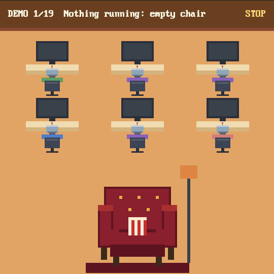

# herdr-sit-and-watch


A sidebar panel for the [Herdr app](https://herdr.dev). Your agents are little robots at their
desks. You are the developer in the red velvet armchair in the corner, watching them do all the
work. The more of them are working, the more excited you get. See
[sitandwatch/RECIPE.md](sitandwatch/RECIPE.md) for how it is built.



## What he does

| Agents working | In the chair |
| --- | --- |
| None | Nobody. An empty chair: Snowy asleep on the back, Buddy on the seat, Simba on the armrest, his popcorn on the floor. |
| One | Popcorn, a foam finger, eyebrows creeping up. "ooh" |
| Two or three | Clapping, wide eyes, sweating. "go on son!" |
| Four or more (or all of them) | Standing ovation, bulging eyes, confetti. "SHIP IT!" |
| One just finished | Party popper and a fist pump, popcorn flying. "GET IN!" |
| One needs you | Spilled popcorn, a tear, a phone call. "they need me?!" ... "on my way..." |
| Two or more need you | Both hands up, head whipping between desks. "which one?!" |
| They all need you, nobody's working | Face down, popcorn everywhere, two tears. "WHY DO I EVEN HAVE AGENTS" |
| Every third new block | The meme: "Are you sure?" over the desk, "Yes" from the chair. |
| One has needed you for 2+ minutes | Half out of the chair, a red arrow on that desk. "THAT one" |
| Three finished within a minute | Standing, both arms pumping, extra confetti. "they're flying!" |
| The same agent finished three times in ten minutes | A gold arrow on its desk, confetti. "HE'S ON FIRE" |
| Six or more working | Chaos: confetti that lingers, faster lines, a bigger head throw. |
| One crashed (exited non-zero) | Hands on his head, popcorn on the floor. "oh no" |
| A new agent appears | A nod, a green arrow on the new desk. "welcome" |
| One has been going 10+ minutes | Glazed over and slumping, a pillow after 30, slumped after 60. "I have a life too" |
| Two or more were busy and all stopped | Drops back into the chair. "ahh" ... "job done" |
| Agents working and you haven't touched Herdr in 5 minutes | Stares at you, eats slowly. "you still watching?" |
| After 10pm | A nightcap. "still at it?" |
| Nothing for 10 minutes | Back in the chair, dozing. "z Z", and now and then "popcorn's getting cold" |
| 10+ agents seen this session | Eyes darting about. "how many are there?" |
| The power bar fills | The bar in the header fills with every second an agent works (20 agent-minutes: about 7 with three at it) and drains slowly when nothing runs. Full: he leaps up, "POWER!", confetti, the pets wide awake. Then it starts again. |
| Desks | In last-active order: whoever's working first, then the one that stopped most recently. A finished agent you haven't looked at shows how long it's been waiting on its screen (`12m`). A desk left alone for an hour gets a cobweb; after 8 hours it's covered, screen dusty. |
| The pets, any time he's there | Buddy, Snowy and Simba sit by the chair giving him a half-lidded side-eye. Meltdown: Buddy covers his eyes. Standing ovation: the cats turn their backs. Something ships: Buddy howls. After 10pm Simba's out. The loudest moment wins. |
| One crashed or needs you (popcorn spilled) | Buddy goes for the popcorn and eats it down over a minute. |
| Two or more at it for 10+ minutes | A cat knocks his can off the armrest (from the chair back once the pillow's there). |
| You click a pet | It says what it thinks of him: "Simba: pathetic", "Buddy: walk?", "Snowy: zzz" if you woke her. |
| Agents busy (now and then) | One of the pets gets up and wanders off the edge, back 25-75s later: Buddy out the left, Snowy and Simba out the right. Never while nothing is running. |
| Something shipped | Explosion with a PR MERGED, DEPLOYED or IT'S LIVE banner, bigger the first time. "KABOOM!" (needs the Claude Code hook, see below) |

Mostly Claude Code agents get a knowing nod, mostly Codex a side-eye, a mix "the whole team's in".
From level 2 there's a can on the armrest, and his scarf leans toward the colour of whoever's doing
most of the work. Each state has a pool of lines, shuffled per session. Click him and he talks back.

Click the header, or run `herdr-app do sitandwatch.demo`, to cycle through all 24 states with labels
(the animation above is one cycle).
Click a desk to jump to that agent.

### Minimise

Click **\_** at the right of the header (or run `herdr-app do sitandwatch.min`) to shrink the panel to a
30px strip: the count, the power bar and his face, still reacting. In the sidebar it's a strip; docked
on the left or right of the window it's a 40px rail. Click **+** to bring it back to the size it had, or
drag it open. If Herdr can't shrink it (no id on its block, two Sit & Watch panels, or a block `min`
over 30), a message says why. Bring it back before removing the mod, or drag the block open after.

### Options

Click **OPTS** in the panel's header, or run `herdr-app do sitandwatch.options`, for:

- **Floor:** slate (the default; the orange and tan pets stand out on it), tan (the original), deep
  teal, sage or night navy.
- **Pets:** switch Buddy, Snowy or Simba off. Their names and coats are the `PETS` table in
  `art.js`.
- **Speech bubbles:** off and he still reacts, silently.
- **Chaos mode** and **developer mode**, the same as their commands below.

Choices are kept in Herdr's shared state, so they survive restarts.

### Developer mode

`herdr-app do sitandwatch.dev` adds a strip under the header with the numbers the mood is picked
from (mood, level, counts, how long things have run, live one-shots). Its `buttons` chip shows rows to
force a level, pin a mood or fire any event. The same works from the command line:

```sh
herdr-app do sitandwatch.level-3          # or level-real
herdr-app do sitandwatch.mood-allBlocked  # any mood name, or mood-auto
herdr-app do sitandwatch.fire-streak      # finish, phone, collapse, burst, error, welcome, poke, merged, ...
herdr-app do sitandwatch.chaos            # chaos mode on for good, or off again
herdr-app do sitandwatch.desks-8h         # pretend idle desks are 1h or 8h old (cobwebs), or desks-real
```

## Installation

Ask your agent to add this mod (it reads every file first), or by hand:

1. Copy `sitandwatch/mods/sitandwatch` into `~/.config/herdr-app/mods/`.
2. Unless you want it somewhere else, it goes in the **bottom-left corner**: the bottom of the
   sidebar, under Agents and above Settings. Herdr won't dock it by itself (`"place": "none"`), so
   add this block to your layout's `sidebar` column, just before `sidebar-footer`:
   ```json
   { "id": "sitandwatch", "type": "block", "content": { "mod": "sitandwatch" }, "size": { "px": 300 } }
   ```
   Herdr's own layouts (`main`, ...) are read-only: clone one first
   (`herdr-app do layout.clone '{"name":"main"}'` makes and switches to `main-copy`) and edit the
   copy. Keep the id `sitandwatch`.

For the explosion on `git push`, `gh pr merge` or a production `vercel` deploy, install the Claude
Code hook in `sitandwatch/hooks/` (setup in [RECIPE.md](sitandwatch/RECIPE.md#ship-hook)).

Delete the folder and that block to remove it (restore it first if minimised). It makes no network requests, runs no programs other than
`hc ls` and `hc get` (to see background agents, crashes and how long each agent has been busy) and
reads no files outside its folder. Nothing animates while
nothing is happening.

## Credits

Built on [zuccs/herdr-office-layout](https://github.com/zuccs/herdr-office-layout) (MIT): the pixel
art helpers, palette, font setup and the full-width office view (`role: "office"`) come from it.
The pixel font is [PxPlus IBM VGA 8x16](https://int10h.org/oldschool-pc-fonts/) by VileR, CC BY-SA
4.0, licence in `sitandwatch/mods/sitandwatch/fonts/`.
