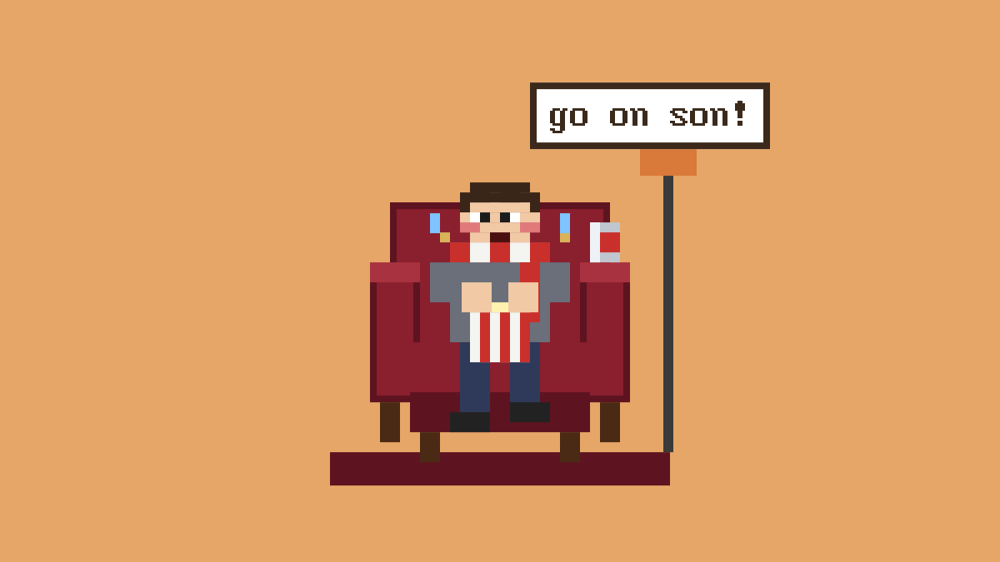

# SitAndWatch

A pixel-art sidebar panel for the Herdr app. Every agent is a little robot at a desk, and below
them a developer sits in a red velvet armchair in the corner, watching them work. The more agents
are working, the more worked up he gets: from an empty chair when nothing is running, through
popcorn and a foam finger, to a standing ovation with confetti. He sobs when an agent needs you and
sets off a party popper when one finishes.



## What you see

One mod, `sitandwatch`, drawn as a narrow panel (made for a sidebar about 260–560px wide). Pixel text
is `PxPlus IBM VGA 8x16` (shipped in `mods/sitandwatch/fonts/`). Nothing is rounded. The panel is a
flex column, top to bottom, on floor colour `#e2a465`:

1. **Header**, 23px, `#8796b0` with a 3px `#7a4a28` bottom border: `N/M AT IT` (12px, `#fff8e1`,
   working agents over all agents) on the left, `DEMO` (10px, `#dfe6f0`) on the right. In the demo
   it grows to 30px, turns `#6b3f1f` and reads `DEMO i/6  <state>` (10px) with `STOP` in `#ffd86a`.
2. **Desks**, filling the remaining height, `overflow_hidden`, 6px top padding: one 84×56 tile per
   agent in a centred wrapping row. A tile holds a 32×20 `#2b2f3a` monitor (28×16 screen), a
   6×3 stand, a 52px desk (`#f0dcb0` top 6px, `#d4b27c` front 4px) and a robot at scale 1.5 seen
   from behind. The tab name (10px) shows only when tiles are at least 60px tall, so not by default.
   - Screen colours: working `#1f4d3a` with three `#7ee0a0` 2px code lines growing and shrinking;
     blocked `#a8322a` with a blinking `!`; done `#24406e`; idle `#36404c`.
   - **Robot**, 16×20 art pixels, about 12 plain rectangles: shoulders in the agent's colour
     (`claude #d97757`, `codex #2f3640`, `gemini #4f7dc9`, ... otherwise a random shirt colour
     fixed by the address), a `#3d4454` chair back, `#2b2f3a` stem and base, a `#9aa3b0` head with
     a `#c4ccd8` top edge, `#e0b040` ear bolts, a `#6e7684` jaw, a `#5a606c` neck and antenna. The
     antenna tip is green `#5ee08a` and blinking while working, red `#e05a5a` otherwise, grey when
     done (head lowered 3px).
3. **Corner**, `devH + 26`px tall, background a glow that warms with the level (`#ffb06a10`,
   `#ffb06a22`, `#ff8a6a30`, `#ff5a5a44`). Centred in it: a 10px `#5e1420` rug, a floor lamp
   (3px `#3a3a3a` pole, 17×13 `#d97a3a` shade) and the **developer in the armchair**, 26×30 art
   pixels at scale 3, 16px from the top.
   - **Armchair**: back `#8a1f2e` with a 2px `#5e1420` border and five `#d9b25a` buttons, arms with
     `#a8323f` tops, seat, `#4a2a14` legs.
   - **Developer**, front view: brown hair `#3a2618`, skin `#f1c9a5`, grey `#6a6f7a` shirt, navy
     `#2f3a5a` trousers, black shoes, a red-and-white `#c9302c`/`#f4f4f0` scarf round his neck, a
     striped popcorn bucket on his lap. A speech bubble (white, 2px `#3b2a1c` border, 12px text)
     sits above his right shoulder.

## How it behaves

The **level** comes from how many agents are working: 0 none, 1 one, 2 two or three, 3 four or
more (or every agent, with at least two). The reactions stack:

| Level | He does | He says |
| --- | --- | --- |
| 0 | Nothing: the chair is empty, a dent in the cushion, popcorn on the seat. | |
| 1 | Bobs slowly, feeds himself popcorn, waves a yellow foam finger, taps a foot, eyebrows creep up, scarf flaps. | `ooh`, `nice`, `go on` |
| 2 | Leans in clapping, eyes wide, brows high, cheeks flushed, sweat drops, bounces. | `look at 'em go`, `go on son!`, `ooh yes` |
| 3 | Standing ovation out of the chair: eyes bulging, jaw dropped, head thrown back, foam finger and fist pumping, popcorn flying, confetti, shaking. | `SHIP IT!`, `!!!`, `MORE AGENTS`, `YES LADS` |

The faces at levels 1–3 follow the escalating chair-reaction meme: brows creeping up, eyes
widening, eyes bulging with the head thrown back.

- **An agent finishes** (working → done): a party popper and a burst of confetti for 3s, `POP!`,
  `GET IN!`, `SHIPPED!`.
- **Something ships** (`herdr-app do sitandwatch.ship`, sent by the Claude Code hook in `hooks/`
  after `git push`, `gh pr merge` or a production `vercel` deploy): a full explosion for about 2.6s.
  A white flash, a fireball of three growing squares (`#c9302c`, `#f08a4a`, `#ffd86a`), 16 bits of
  debris flung outward and a `KABOOM!` caption. He jumps to a standing ovation: `KABOOM!`,
  `IT'S LIVE!`, `LEGENDS`.
### Moods

On top of the level, `resolveMood(m, level)` in `panel.js` picks one dominant mood, first match
wins, and `spectator()` draws that one pose and speech set. `m` comes from `trackMetrics()` in
`main.js` (or a demo state):

| Mood | When | He does | Says |
| --- | --- | --- | --- |
| `streak` | the same agent's 3rd finish within 10 min (4 ticks) | level 3 pose, extra confetti, gold arrow at that desk | streak pool |
| `burst` | 3 finishes within 60s (6 ticks) | level 3 pose, both arms pumping at 150ms, 14 more confetti | `they're flying!`, `yes lads` |
| `error` | an agent we showed exited with code > 0 (4 ticks) | hands on head, eyes squeezed, grimace, sweat, popcorn spilled, small shake | `oh no`, `that's not good` |
| `collapse` | 2+ working dropped to none (5 ticks) | see below | `ahh`, `job done` |
| `finish` | working to done (3 ticks) | the fist pump below | `GET IN!` |
| `allBlocked` | 2+ blocked and none working | face down (hair over the face), two tears, popcorn all over the rug | meltdown pool |
| `multiBlocked` | 2+ blocked | both hands up, head whipping left and right | `which one?!`, `too many` |
| `pointAtBlocked` | one blocked 2+ min | half out of the chair, foam finger up reading `THAT`, red arrow at that desk | `THAT one`, `<tab>!` |
| `areYouSure` | every 3rd newly blocked agent, instead of the phone (4 ticks) | calm, seated; `Are you sure?` bubble over that desk | `Yes` |
| `blocked` | one blocked | the phone, then the blocked pose below | |
| `welcome` | a new desk (3 ticks; not in the first 15s) | a nod, `hi` on the finger, green arrow at the new desk | `welcome`, `hi <tab>` |
| `slumped` / `glazedHard` / `glazed` | longest working 60 / 30 / 10+ min | glazed, below; pillow from 30, lids lower at 60 | `I have a life too`, `hmm`, `still going...` |
| `fourthWall` | agents working, no focus change or header click for 5 min | wide eyes, one brow up, eating slowly | `you still watching?` |
| `longIdle` | nothing working or blocked for 10 min | back in the chair asleep: lids shut, chin down, a still `z Z` | an idle line for 30s in every 3 min, else silent |
| `lateNight` | 10pm to 6am, someone working | level pose | `still at it?` |
| `howMany` | 10+ agents seen since the panel started | eyes darting | `how many are there?` |
| `normal` | otherwise | level pose | level lines |

- **Lines** live in `lines.js`, one pool per state (levels 1 to 3, finish, blocked, ship, streak,
  meltdown, idle, poke). `pool(name, seed)` shuffles a pool with the session's seed and puts the
  original line first, and `frames()` cycles it natively. The pixel font has no curly quotes.
- **Chaos** at level 3 when 6+ are working, or always after `herdr-app do sitandwatch.chaos`
  (remembered in `localStorage`): 12 more confetti at 1.8× the period, lines every 500ms, a bigger
  head throw.
- **Can** on the right armrest from level 2. **Tint**: the scarf and foam finger stripe move 35%
  toward the shirt colour of whoever has the most working agents.
- **Level-up**: reaching level 3 warms the corner glow for 2 ticks. **Linger**: 3 confetti bits
  drift for a second after the party popper ends.
- **Click him**: 2 ticks of a line from the poke pool, his head turned a pixel. A click counts as you
  being around. A transparent target sits on top of the drawing so the pixels can't swallow it.
- **Nightcap** (blue with a white bobble) whenever it's 10pm to 6am and he's in the chair.
- **Provider flavour**, in the `normal` mood only, from `program.key` (or hc's `agent`): more than
  half Claude, a slow nod; more than half Codex, a side-eye; two or more kinds, `the whole team's in`
  joins the lines.
- **Ship**: 24 bits of debris (32 and 1.5× for the first of the session, with `FIRST ONE!`), and a
  banner that fades after 2s. The hook sends `sitandwatch.ship-merged` (gh pr merge),
  `ship-deployed` (vercel) or `ship-pushed` (git push), shown as `PR MERGED`, `DEPLOYED`, `IT'S LIVE`.
- **Where the numbers come from**: Herdr's agent list has no start times or errors. Every 10s the
  panel runs `hc ls --all --json` (finished terminals carry `exit_code`) and `hc get <t> --json` for
  each working or blocked one (`status_ms` is when it entered that status, so durations survive a
  reload). Until hc has answered, it uses the time it saw the status change itself. Context use isn't
  reported anywhere, so there's no "getting full" mood.

### One-shot details

- **An agent finishes** also gives a fist pump for 3 ticks: right fist up for two, the popcorn
  bucket tipped right (the top half stepped a pixel over) with kernels flying further each tick,
  `GET IN!`, and `LIVE` on the foam finger.
- **An agent becomes blocked**: a 4-tick phone call. A grey 2×3 phone in his left hand, its screen
  flashing white on the second tick, gone on the last. `they need me?!`, `noooo`, `on my way...`.
  It plays once per newly blocked agent, then the plain blocked pose below takes over.
- **Glazed**: he calms to the level 1 pose with every loop stopped, half-closed eyes, the body
  sliding down over 3s (2px, 3px, 4px for the three depths). Lines change every 8s.
- **Two or more agents were working and now none are** (collapse): 5 ticks. A 1px lift, the drop
  back into the chair with the cushion giving, eyes shut for a tick, a half smile. `ahh`, `job done`.
  Then the empty chair.
- **Foam finger** words: `ooh` at level 1, `SHIP`/`LADS` at level 3, `LIVE` during a party or ship,
  `THAT` and `hi` for their moods.
  Level 2 has no finger (he's clapping).
- **An agent is blocked**: the mood drops to at most level 1, a sad mouth, a tear, the popcorn
  spilled on the floor, `wah wah`, `they need me?!`, `noooo`.
- **Clicking a desk** focuses that agent (`agent.focus`).
- **Demo**: clicking the header, or `herdr-app do sitandwatch.demo`, cycles 24 labelled states
  every 5s with fake desks: the three levels, finished, blocked, shipped, one per mood, and the empty
  chair last. `demo.gif` is a recording of one cycle. Again to stop.
- **Developer mode**: `herdr-app do sitandwatch.dev` (remembered) shows a strip under the header with
  the mood, level, counts and durations it's picked from, and the live one-shots. Its `buttons` chip
  opens rows to force a level, pin a mood (one-shots still take over while they run) or fire any
  one-shot as the real event would. Commands do the same: `level-<0..3|real>`, `mood-<name|auto>`,
  `fire-<event>`.
- Every motion is a native `loop` or `frames`; nothing animates when nothing is happening.
- No keys and no hovers: it takes no keys, so there is no `keys.json` to merge.

## Built from

- `mods/sitandwatch/mod.json`: `{ "place": "left", "size": 280, "title": "SitAndWatch" }`.
- `mods/sitandwatch/panel.js`: the panel (`panel(list, party, opts)`), desks, `devLevel(list)` and
  `resolveMood(m, level)`.
- `mods/sitandwatch/lines.js`: what he says, `pool()` and `pickLine()`.
- `mods/sitandwatch/art.js`: sprites as rows of palette letters (`sprite(rows, palette, s)` draws one
  `div` per colour run), `bot()` from plain rectangles, `spectator(level, s, id, { panic, party, ship, mood, fx, ... })`,
  `explosion()`.
- `mods/sitandwatch/main.js`: one view, its job picked by `props().role`: `panel` (the default), or
  `office`, `rail` and `pane` for a full-width office layout like the one it is based on (the
  office draws the same developer in the bottom-left corner).
- The list is `agents()` plus background helpers (`hc run --bg`), which are not in `agents()`:
  `hc(["ls", "--all", "--json"])` every 10s in a `cx.spawn`, live terminals with a status, merged by
  address. The same poll finds crashes and asks `hc get` for status times. A 1s timer advances the
  demo, ends the party and counts down the one-shots.
- Commands through `nextCommand()`: `demo`, `dev`, `chaos`, `ship` and `ship-<kind>`, `fire-<event>`,
  `mood-<name>`, `level-<n>`. Calls `agents()`,
  `hc` (`ls`, `get`), `run("agent.focus")`.
  No network, no `exec`, no files outside its folder.
- Based on [zuccs/herdr-office-layout](https://github.com/zuccs/herdr-office-layout) (MIT): its
  `art.js` helpers, palette, font and office view.

## Watch out

- Herdr cuts a render off ("This view could not be re-rendered ... interrupted") when it runs too
  long. Draw the robots with a dozen rectangles, not `sprite()`: at one `div` per colour run, seven
  sprite robots and the developer were enough to hit it. Several animated developers in one view
  hit it too, so the demo shows one state at a time.
- Don't call `terminals()` during render: it can be slow (remote machines) and gets the render cut
  off. Poll `hc ls --json` off the render path.
- Don't lay the panel out from a measured height (`on_size_change` + `cx.notify()`): Herdr's error
  banner changes the height, which re-renders, which removes the banner, and round it goes. Use
  flex: fixed header, `flex_1` desks, fixed-height corner.
- `loop` always swings there and back, so it can't play a one-time burst. The explosion renders
  squashed (stage 0), then 60ms later blown out (stage 1) with the same ids, and `transition()`
  animates the change once.
- The one-shots count down in ticks of the 1s timer, which re-renders while one runs and every 15s
  otherwise, so the minute-based moods catch up. Their edges (finish, newly blocked, busy to none,
  new desk, focus change) are found in render against the previous statuses, like the party popper.
- The demo toggles: `herdr-app do sitandwatch.demo` while it runs stops it, and a mod reload (any
  file in the folder changing) stops it too. Look at the header (brown with `STOP` means on) before
  recording it.
- A reload, or Herdr rebuilding the view, leaves the old `nextCommand()` loop waiting alongside the
  new one, and its `cx` keeps working, so it takes commands and changes a view nobody sees. Each
  panel build writes a token to `localStorage` when it starts, and a loop whose token isn't the
  latest hands the command on with `run("sitandwatch.<command>")` and stops. Builds from before this
  fix can only be cleared by restarting the window.
- Don't call `setShared()` from `init`: it re-renders every mod, and a re-render that rebuilds views
  runs `init` again.
- `herdr-app shot` saves the last frame the window drew. With the Mac locked or the display asleep
  nothing is drawn, so shots go stale. Keep it awake (`caffeinate -u`) while recording.
- `loop` periods must be at least 100ms. Loops need a stable `.id()`; put the level in the id so
  they restart at the new speed when it changes.
- `herdr-app check` renders the default role, the panel, with no agents: it can't show levels 1–3.
  Use the demo.
- Claude Code's own subagents (its Agent tool) run inside one terminal, so they don't get desks.
- More than about two rows of desks are hidden behind the corner in a short panel.

## Done when

- With the mod in a sidebar and no agent working, the chair is empty.
- Starting an agent brings the developer in with popcorn and a foam finger; four working agents
  get a standing ovation with confetti.
- An agent asking for permission turns its screen red and makes him cry `wah wah` over spilled
  popcorn; an agent finishing sets off the party popper.
- `herdr-app do sitandwatch.demo` cycles all 24 states with labels, and `herdr-app status` reports no
  errors throughout.
- Clicking a desk focuses that agent.
- `herdr-app do sitandwatch.ship`, or a `git push` from Claude Code with the hook installed, sets off
  the explosion, which clears by itself.

## Ship hook

`hooks/sitandwatch-ship.py` is a Claude Code `PostToolUse` hook. Copy it to `~/.claude/hooks/` and
add to `~/.claude/settings.json`:

```json
"PostToolUse": [
  { "matcher": "Bash", "hooks": [{ "type": "command", "command": "~/.claude/hooks/sitandwatch-ship.py", "async": true, "timeout": 10 }] }
]
```

`is_ship()` in the script decides what counts as shipping.
